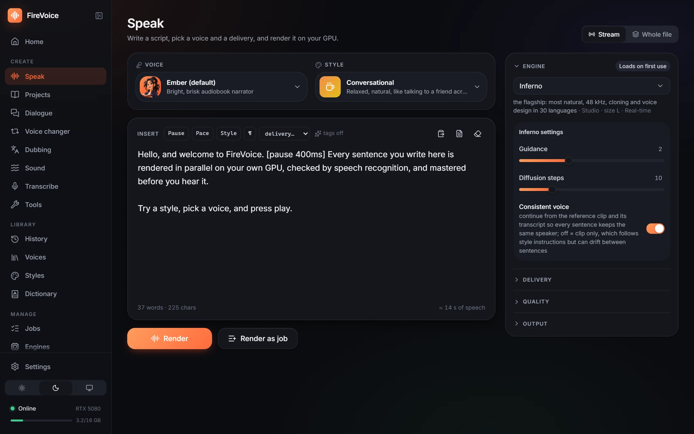
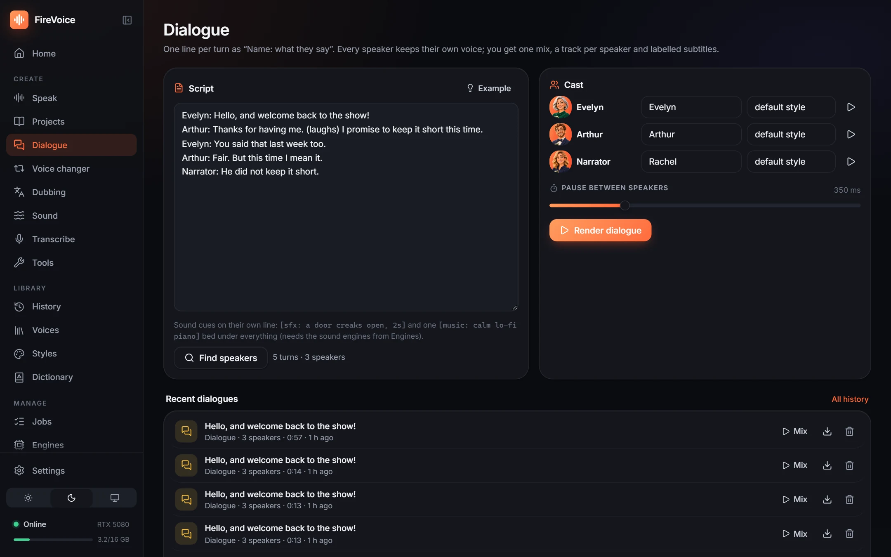
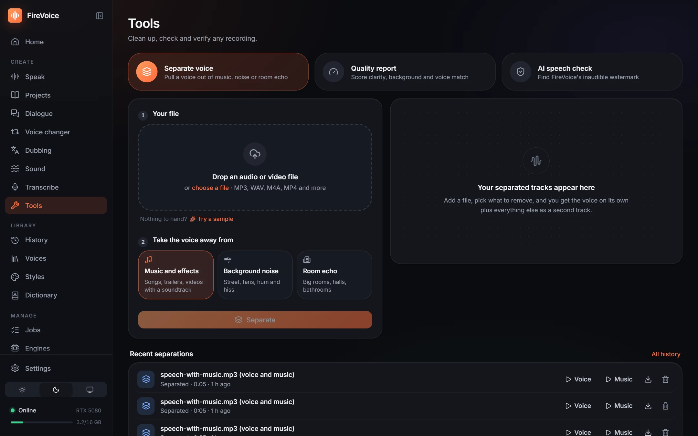
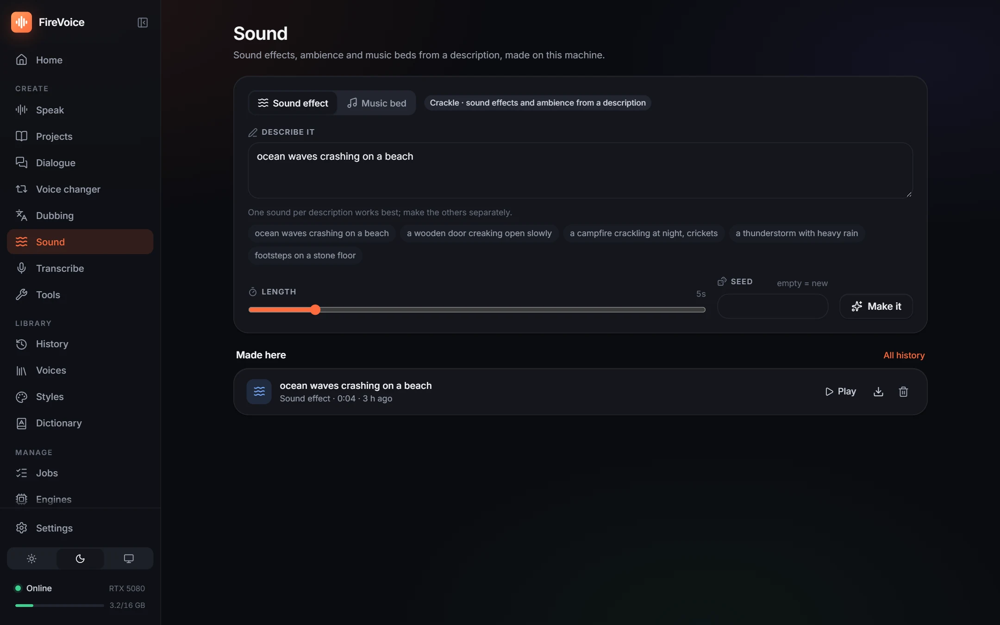
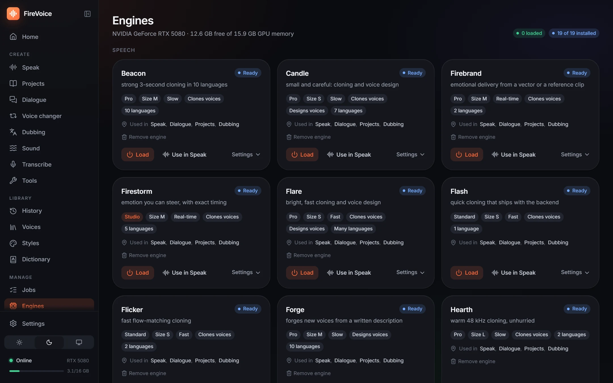

  

<h1 align="center">FireVoice</h1>

  <b>Natural voices, made on your own computer.</b> 
  Expressive text to speech, voice cloning and design, dialogue, dubbing, transcription, music and sound effects,
  all running locally on your computer.

  <a href="https://firevoice.fabwaseem.com/download/windows"><b>Download for Windows</b></a>
  &nbsp;·&nbsp;
  <a href="https://firevoice.fabwaseem.com/download/linux"><b>Download for Linux</b></a>
  &nbsp;·&nbsp;
  <a href="https://github.com/fabwaseem/firevoice-releases/releases">All releases</a>

  

## A look inside

<table>
  <tr>
    <td width="50%"> <b>Voices</b>: a library of 100 voices, plus your own clones and voices designed from a description.</td>
    <td width="50%"> <b>Dialogue</b>: write "Name: line", cast a voice per speaker, get one mix and a track per speaker.</td>
  </tr>
  <tr>
    <td width="50%"> <b>Tools</b>: pull a voice out of music, score a recording's quality, check for AI speech.</td>
    <td width="50%"> <b>Sound</b>: sound effects, ambience and music beds from a description.</td>
  </tr>
  <tr>
    <td colspan="2"> <b>Engines</b>: choose the voice engine that fits: studio quality, fast, small, many languages. Install only what you use.</td>
  </tr>
</table>

## Download

Get the latest version from **[Releases](https://github.com/fabwaseem/firevoice-releases/releases/latest)**:

- `FireVoice_<version>_x64-setup.exe`: the installer (recommended) · [download the latest](https://firevoice.fabwaseem.com/download/windows)
- `FireVoice_<version>_x64_en-US.msi`: the same app as an MSI package · [download the latest](https://firevoice.fabwaseem.com/download/windows-msi)

**Linux** (64-bit; Ubuntu 22.04 or newer, Debian 12, Fedora 38 and similar):

- `FireVoice_<version>_amd64.AppImage`: runs on any distribution and updates itself (recommended) · [download the latest](https://firevoice.fabwaseem.com/download/linux). Make it executable
  (`chmod +x FireVoice_*.AppImage`) and open it.
- `FireVoice_<version>_amd64.deb` · [download the latest](https://firevoice.fabwaseem.com/download/linux-deb): Ubuntu, Debian, Mint, Pop!_OS (`sudo apt install ./FireVoice_*.deb`)
- `FireVoice-<version>-1.x86_64.rpm` · [download the latest](https://firevoice.fabwaseem.com/download/linux-rpm): Fedora, openSUSE, RHEL (`sudo dnf install ./FireVoice-*.rpm`)

## What you need

- Windows 10 or 11, 64-bit, or a 64-bit Linux (see above)
- An NVIDIA graphics card is recommended: the bigger engines need one. Without one (an AMD or Intel card, or none),
  FireVoice runs on the processor with the engines that suit it, and the Engines page says which ones those are
- An internet connection for the first start: FireVoice sets up its voice engine once (a few GB with an NVIDIA card,
  much less without)
- Free disk space for the engines you choose to install (each engine's size is shown before it downloads)

## Updates

FireVoice keeps itself up to date. When you are online and a new version is out, it downloads and installs it on
start, then opens the new version (on Linux, the AppImage updates itself; the .deb and .rpm are updated by installing the
new package); your voices, history and settings stay as they are. Offline, it opens as usual.

Every update is signed, and FireVoice refuses to install one whose signature does not match. Each release also lists
the SHA-256 of its installers in `SHA256SUMS.txt`.
